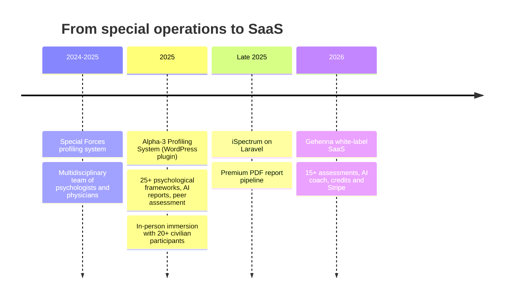
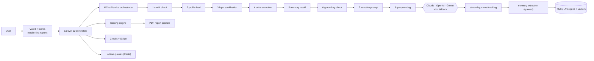

# iSpectrum / Gehenna — psychometric profiling and AI coaching platform

> **Showcase repository.** The source code is private; this page documents what the system does, its history and how it is built.
> Built by [Roderick Specter](https://github.com/rodcoding123).

iSpectrum is a psychometric profiling platform that maps a person's strengths, limiting beliefs and blockers, and turns that map into personalized development. It started as a system built with the **Brazilian Special Forces**: a tool to understand each soldier's psychology and adapt training for faster psychological, emotional and physical development with fewer setbacks. It was then adapted for civilians (Alpha-3) and rebuilt as **Gehenna**, a white-label SaaS that can be configured for any market: fitness, self-development, HR and couples.

---

## Evolution of the system

### My role
- Led a **multidisciplinary team** of psychologists and physicians to define what to measure and how to interpret it
- Designed and engineered the platform end to end: assessment engine, scoring engine, AI reporting, AI coach, payments
- Designed the methodology for combining **self-perception with computed scores** (a Johari-window style analysis of blind spots and hidden potential)

---

## What it does

### Assessments
- **15+ assessments** in the SaaS (Big Five, Enneagram, ACE, PAI-32, CIS-5, Life Wheel and more), organized in modules: Personality Core, Cognitive Style, Emotional & Relational Intelligence, Inner Dynamics, Life Context
- Earlier Alpha-3 engine with **25+ psychological frameworks**, including core-belief mapping (helplessness, unlovability, worthlessness), 10 "internal saboteurs", resilience, grit and decision-making styles
- **Context-aware interpretation**: life history, career and training are captured so that a trained behavior is not mistaken for a natural tendency
- Session-based flow with resume, reverse scoring, normalization and percentile calculation

### Reports
- **Premium PDF reports** generated by a strict pipeline (WeasyPrint, custom SVG charts) with built-in quality rules: rescore every item from raw data, avoid the Barnum effect, pair every strength with its shadow, and run a visual inspection loop on every page before delivery
- Two report voices: a **technical report** for instructors and professionals, and a **narrative report** for the person
- **Couple compatibility reports**

### AI coach
- Personalized coaching grounded in the person's profile
- **Multi-provider LLM** routing (Claude primary, OpenAI and Gemini fallback) with SSE streaming
- **Multi-layer crisis detection** with escalation to human resources
- **Cross-session semantic memory** with vector search
- Voice input (Whisper), per-request token and cost tracking

---

## Architecture (Gehenna)

---

## Tech stack

| Layer | Technology |
|---|---|
| Backend | PHP 8.3, Laravel 12, Horizon, Redis |
| Frontend | Vue 3, Inertia.js, Tailwind CSS |
| AI | Anthropic Claude, OpenAI, Google Gemini, Whisper, vector memory |
| Reports | WeasyPrint, custom SVG charting |
| Payments | Stripe credit system |
| Legacy | WordPress plugin (Alpha-3 Profiling System v2.1) |

---

## What this project shows

- Translating expert knowledge (psychology, medicine, military training) into software
- Responsible AI in a sensitive domain: crisis detection, grounding, no pseudo-scientific claims
- Productizing a bespoke system into a configurable, multi-market SaaS

---

**Want something like this?** I build AI products end to end, from domain research to production. Reach me through my [GitHub profile](https://github.com/rodcoding123) or Upwork.
